::: message-strip information
This guideline now covers both SAPUI5 and SAP Web Components. Learn More.
:::

## Intro

Expandable text is a UI component that displays long text in a collapsed or expanded state. By default, it shows a short preview with a Show More link to reveal the full content and a Show Less link to collapse it again. Depending on the use case, the text can expand inline or open in a popover.

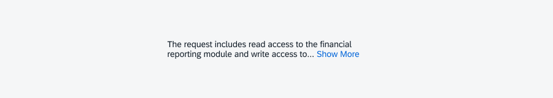
Caption: Expandable text

### Component availability

This component is available in the following libraries:

| **Library** | **Technical Name** | **Identifier** |
| --- | --- | --- |
| SAPUI5 Demo Kit | [sap.m.ExpandableText](https://ui5.sap.com/#/entity/sap.m.ExpandableText) | :badge, info, large, _, SAPUI5: |
| SAP Web Components | [ui5-expandable-text](https://ui5.github.io/webcomponents/components/ExpandableText/) | :badge, info, large, _, SAP Web Components: |
| SAP Web UI Kit (Figma) | [Expandable text](https://www.figma.com/design/SILcWzK5uFghKun9jx6D7c/SAP-Web-UI-Kit?node-id=1216-2955) | :badge, info, large, _, Figma: |

::: info toptip
- Choose inline expansion when space allows and the surrounding context helps users understand the full text.
- Choose expanded in [popover](https://www.sap.com/design-system/fiori-design-web/ui-elements/popover) mode when inline expansion would disrupt the layout.
- Set the character limit based on the use case. For example, a form and a list row may need very different thresholds.
- Rewrite the text instead of relying on truncation whenever it can be shortened without losing meaning.
- Use expandable text only for optional details. If users need the full content to complete a task, show it by default.
:::

## When to Use

::: do
Use the expandable text to:

- Handle long texts or descriptions inside a responsive table, list or form.
- Provide access to truncated text.
:::

::: dont
Don't use the expandable text to:

- Handle text overflow in UI tables (grid table, tree table, analytical table) or the Gantt chart.
- Display content for which a short and meaningful alternative exists.
- Hide only non-critical content. Use short descriptions that fit into the available space instead.
:::

## Anatomy

The expandable text consists of the following elements:

1. **Main text:** The truncated content displayed when the component is in its collapsed state.
2. **Popover with expanded text:** A floating container that displays the full text content. The [popover](https://www.sap.com/design-system/fiori-design-web/ui-elements/popover) can include an arrow pointer on any of its four sides.
3. **Expand/collapse link:** A _Show More_/_Show Less_ link that expands or collapses the component.

**Note**: The _Show More_/_Show Less_ link labels are predefined and cannot be changed. Translations are handled automatically by the component.

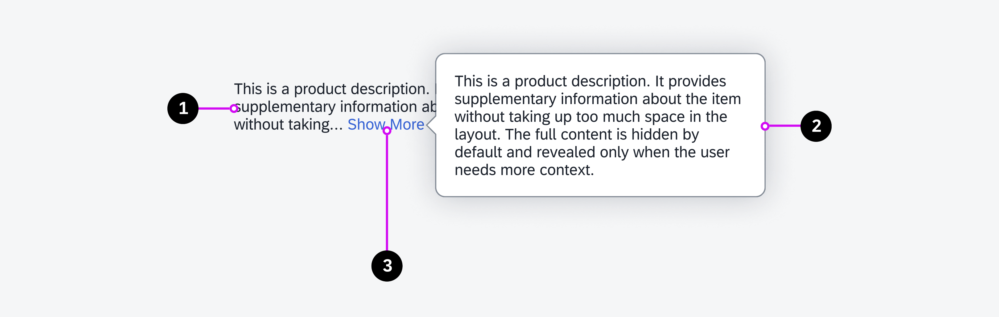
Caption: Expandable text anatomy

## Types

### Collapsed text

The initial state of the component. Content is truncated and followed by a _Show More _link.

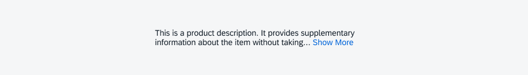
Caption: Expandable text - collapsed

### Expanded in place

Displays the full content within the same container, replacing the truncated text. Show _Less link_ is added at the end to let the user collapse it back.

Caption: Expandable text - expanded in place

### Expanded in popover

Displays the full content in a floating popover positioned relative to the expand text link - see the [Anatomy section.](https://www.figma.com/design/6ABLVcHviDazNmcCG503pg?node-id=11-2458)

## States

### Component states

The enabled state is the default state of the expandable text.

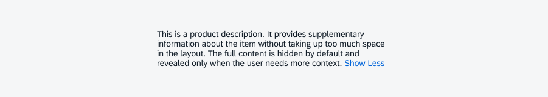
Caption: Enabled state of the expandable text

### Interaction states

The expandable text component inherits the interaction states for the Show More/Show Less link only.

**A. Regular:** The default state of the link.

**B. Hover:** Displayed when the cursor moves over the link.

**C. Down:** Displayed while the link is being activated.

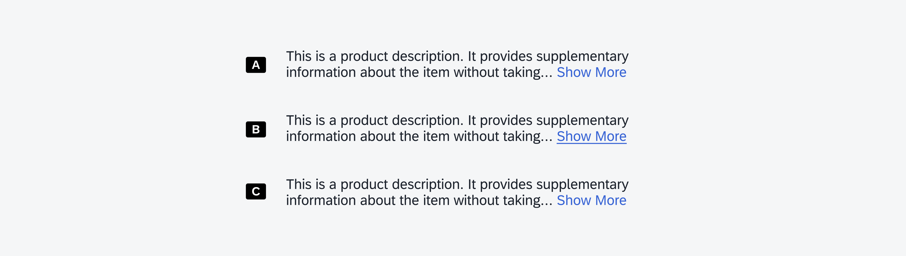
Caption: Interaction states of expandable text

For more information, see [Interaction States](https://www.sap.com/design-system/fiori-design-web/foundations/interaction/states/interaction-foundations-interaction-states).

### Focus

The focus state indicates the element that currently has keyboard focus. In the expandable text component, focus is applied to the Show More/Show Less link only.

**A. Unfocused:** The default state of the link when it has not received focus.

**B. Focused:** Displayed when the link receives focus, visualized with a focus highlight around it.

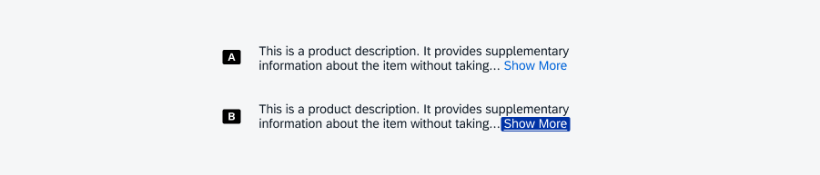
Caption: Expandable text - focus state

For more information, see [Focus state](https://www.sap.com/design-system/fiori-design-web/v1-136/foundations/interaction/states/interaction-foundations-focus-states).

### Empty state

Display an en dash (–) to denote empty content and make values easier to scan in forms and similar contexts. 
The symbol may vary depending on the user's language.

Caption: Expandable text - empty state

For more information, see [Empty States](https://www.sap.com/design-system/fiori-design-web/foundations/best-practices/global-patterns/designing-for-empty-states).

## Behavior and Interaction

### Expanding/Collapsing

The expandable text expands either inline or in a popover. Clicking _Show More_ reveals the full content. The text is selectable and the user can copy it in both collapsed and expanded modes.

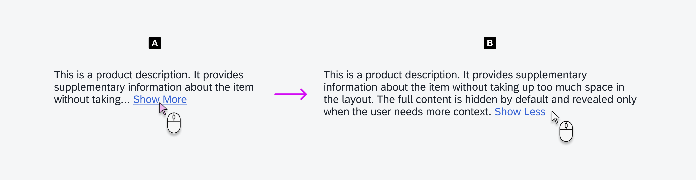
Caption: Collapsed (A) and expanded in place (B)

Clicking Show Less or outside the popover collapses the text.

Caption: Collapsed (C) and expanded in popover (D)

### Gestures and Mapping

The behavior is similar to mouse interaction.

For more information, see [Gestures](https://www.sap.com/design-system/fiori-design-web/foundations/interaction/gestures#tap-press-and-release).

## Responsiveness

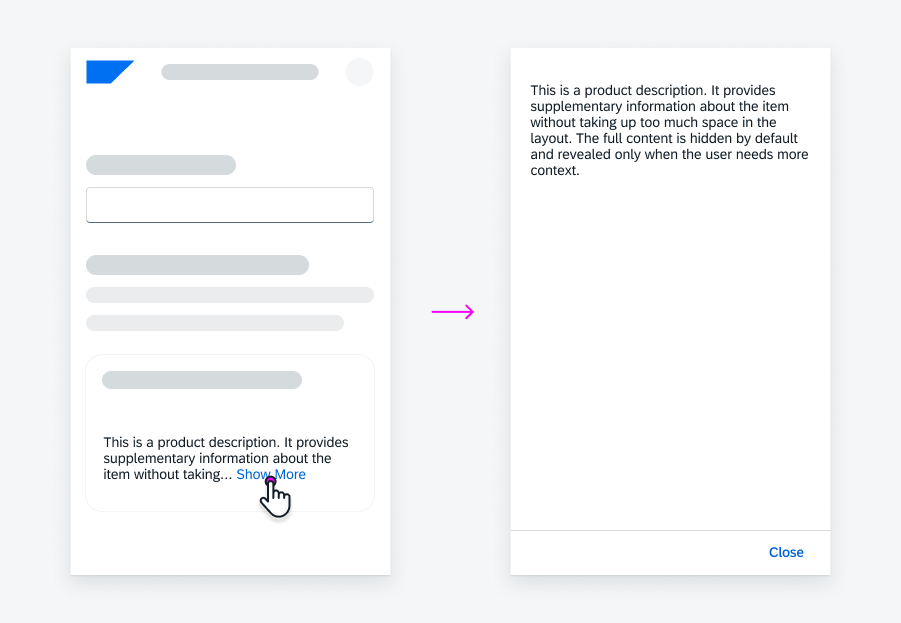
Caption: Expandable text on mobile device

For more information, see [Content Density](https://www.sap.com/design-system/fiori-design-web/v1-136/foundations/visual/cozy-compact).

The expandable text is responsive and supports all screen sizes. It does not change size between compact and cozy content densities.

The expandable text supports inline and popover expansion on all screen sizes. On mobile, popovers don't float, they open as a full-screen overlay, making it easier to read and interact with the content.

## Accessibility

SAP follows international standards, such as WCAG and WAI-ARIA, and strives to make our business solutions accessible and inclusive. For more information, see [Accessibility in SAP Fiori](https://www.sap.com/design-system/fiori-design-web/discover/sap-design-system/product-standards/accessibility-in-sap-fiori) and the [Accessibility Design Tools Handbook](https://www.sap.com/documents/2023/11/bc210d8b-977e-0010-bca6-c68f7e60039b.html).

### Keyboard Navigation

Keyboard interaction is supported through the Show More / Show Less link, which follows the keyboard behavior of the [Link](https://www.sap.com/design-system/fiori-design-web/ui-elements/link) component.

### Screen Reader Support

Screen readers read plain text through the virtual cursor, also known as browse mode or the virtual PC cursor.

Plain text cannot receive keyboard focus, so users do not navigate to it using the Tab key. Instead, screen reader users read plain text using commands that move by line, word, character, heading, list, or section.

## Content

### Wrapping and Truncation

The expandable text wraps and truncates according to the available space. Text exceeding 100 characters is truncated and followed by a _Show More_ link.

**A. More than 100 characters:** Text truncates and shows a _Show More_ link.

**B.** **Less than 100 characters:** Text is displayed in full and no _Show More_ link.

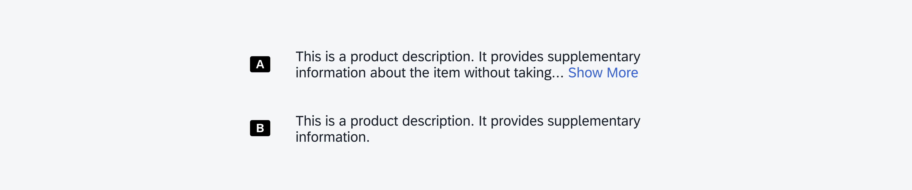
Caption: Truncation in the expandable text

### Hyphenation

When hyphenation is enabled, it affects both the collapsed and expanded states.

**A. Collapsed mode with hyphenation:** Text truncates and shows a _Show More_ link.

**B. Expanded in popover with hyphenation:** The full content in the popover is displayed with hyphenation.

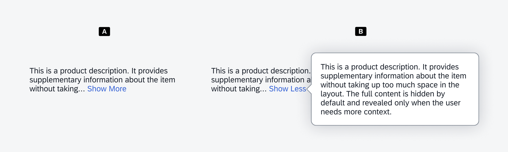
Caption: Collapsed with hyphenation (A) and expanded in a popover with hyphenation (B)

For more information, see [Wrapping & Truncation](https://www.sap.com/design-system/fiori-design-web/foundations/interaction/wrapping-and-truncation)  and [Wrapping and Truncating Text](https://www.sap.com/design-system/fiori-design-web/foundations/writing-and-wording/ux-writing/wrapping-and-truncating-text).

### Localization

The expandable text supports left-to-right (LTR) and right-to-left (RTL) reading directions. All features are supported in both directions.

::: columns 2
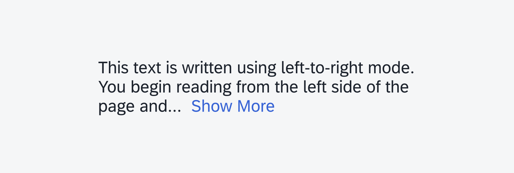
Caption: Expandable text in left-to-right mode

--- column ---

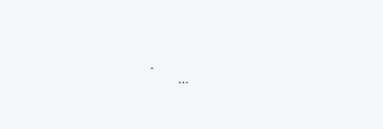
Caption: Expandable text in right-to-left mode
:::

## Features

### Preserve whitespace

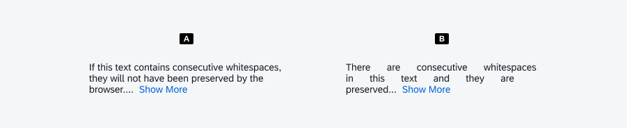
Caption: Expandable text with preserved whitespace

### Text align

Caption: Text alignment - left, right, and center

## Framework Comparison

There are no differences between SAPUI5 and SAP Web Components regarding the component's behaviors and framework-specific patterns.

## Related Links

[internal_only]

::: columns 3
#### Guidelines

Components

[Text](https://www.sap.com/design-system/fiori-design-web/v1-151/ui-elements/text)

[Link](https://www.sap.com/design-system/fiori-design-web/v1-151/ui-elements/link)

[Popover](https://www.sap.com/design-system/fiori-design-web/v1-151/ui-elements/popover)

--- column ---

#### Implementation

SAPUI5

[Expandable text](https://ui5.sap.com/#/entity/sap.m.ExpandableText) (samples)

[Expandable text](https://ui5.sap.com/#/api/sap.m.ExpandableText) (API reference)

UI5 Web Components

[Expandable text](https://ui5.github.io/webcomponents/components/ExpandableText/)

--- column ---

#### Specifications

[Text](https://wiki.one.int.sap/wiki/spaces/visualcore/pages/2698915836/Text+Horizon) (visual design)

[Link](https://wiki.one.int.sap/wiki/spaces/visualcore/pages/2698914103/Link+Horizon) (visual design)

#### SAP Web UI Kit

[Text](https://www.figma.com/design/SILcWzK5uFghKun9jx6D7c/SAP-Web-UI-Kit?node-id=224294-72)
:::

[/internal_only]

[external_only]

::: columns 3
#### Guidelines

Components

[Text](https://www.sap.com/design-system/fiori-design-web/v1-151/ui-elements/text)

[Link](https://www.sap.com/design-system/fiori-design-web/v1-151/ui-elements/link)

[Popover](https://www.sap.com/design-system/fiori-design-web/v1-151/ui-elements/popover)

--- column ---

#### Implementation

SAPUI5

[Expandable text](https://ui5.sap.com/#/entity/sap.m.ExpandableText) (samples)

[Expandable text](https://ui5.sap.com/#/api/sap.m.ExpandableText) (API reference)

UI5 Web Components

[Expandable text](https://ui5.github.io/webcomponents/components/ExpandableText/)

--- column ---

#### UI Kit (Figma)

[SAP Fiori for Web UI Kit ](https://www.figma.com/community/file/1494295794601744471)[/](https://www.figma.com/community/file/1494295794601744471)

Text
:::

[/external_only]
