::: message-strip information
This guideline now covers both SAPUI5 and SAP Web Components. Learn More.
:::

## Intro

The tab bar is a UI component that contains a set of tabs, each linking to a different content area or view. Use the tab bar to navigate between sections of content, to filter a list of items, or to visualize process steps.

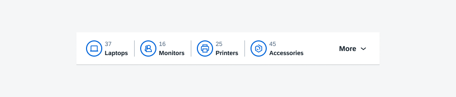
Caption: Tab bar

### Component availability

This component is available in the following libraries:

| **Library** | **Technical Name** | **Identifier** |
| --- | --- | --- |
| SAPUI5 Demo Kit | [sap.m.IconTabBar](https://ui5.sap.com/#/entity/sap.m.IconTabBar) | :badge, info, large, _, SAPUI5: |
| SAP Web Components | [ui5-tabcontainer](https://ui5.github.io/webcomponents/components/TabContainer/) | :badge, info, large, _, SAP Web Components: |
| SAP Web UI Kit (Figma) | [Tab Bar](https://www.figma.com/design/SILcWzK5uFghKun9jx6D7c/SAP-Web-UI-Kit?node-id=1216-3190) | :badge, info, large, _, Figma: |

::: info toptip
- Use the tab bar only for switching between tabs. Avoid cross-navigation, such as opening another tab from an item inside the current tab, as it breaks back navigation and confuses users.
- Choose icon-only tabs when you have 4–5 tabs that are clearly identifiable by their icon. Choose text-only tabs when you have more tabs or no clear icons to represent them.
- Apply labels consistently: either all tabs have a label or none do.
- Use semantic colors only when users need to take action, such as an error or a critical situation. Otherwise, use the neutral default colors.
- Always pair a semantic color with a semantic icon and matching tab text, so meaning is conveyed by more than color alone.
- For processes with a fixed order, disable tab reordering so consecutive steps can't be rearranged.
- Show a tab badge only when new items are triggered from outside the app, not when users add items themselves.
- Hide tabs that have no content and can't receive any. Show an empty tab only when users can add content to it, such as notes or attachments.
:::

## When to Use

::: do
Use the tab bar to:

- Show multiple facets of a business object at the same time
- Let users browse through those facets.
- Provide a prominent, highly visual filter above a list.
- Visualize clear-cut process steps.
:::

::: dont
Don't use the tab bar to:

- Show only a single tab
- Lay out tabs in a responsive table or grid. Use the [table toolbar](https://www.sap.com/design-system/fiori-design-web/ui-elements/table-bar) instead
- Display hierarchical navigation. Use a [tree](https://www.sap.com/design-system/fiori-design-web/ui-elements/tree) or [breadcrumb](https://www.sap.com/design-system/fiori-design-web/ui-elements/breadcrumb) component instead
- Navigate to unrelated pages. Use [links](https://www.sap.com/design-system/fiori-design-web/ui-elements/link) or navigation components instead
:::

## Anatomy

### Tab bar

The tab bar consists of the following elements:

1. **Tab:** Represents a navigation item that displays its corresponding content when selected.
2. **Separator:** Separates the tabs visually.
3. **Main bar:** Contains the tabs, tab separators, and the overflow menu.
4. **Overflow menu:** Contains any remaining tabs that can't be displayed in the available space.
5. **Content area:** Displays the content associated with the currently selected tab.

Caption: Tab bar anatomy

### Tab

The tab consists of the following elements:

1. **Icon (optional):** Displays a symbol that visually represents the tab's content.
2. **Counter (optional):** Displays the number of items in the tab.
3. **Text:** Contains the text shown for the tab.
4. **Selection bar:** Indicates that the tab is selected. Its length depends on the tab type.
5. **Drop-down icon:** Opens the drop-down that holds the subtabs.
6. **Subtabs drop-down:** Tabs grouped under a parent tab. For more information, see [Hierarchies](https://www.sap.com/design-system/fiori-design-web/ui-elements/icontabbar#hierarchies).

Caption: Tab anatomy

## Types

The tab bar supports four tab types: text tabs, icon tabs, filter tabs, and process tabs. Choose the type based on whether users need to switch between content areas, filter content, or navigate through a process.

### Text tabs

Text tabs display a text label with an optional count. Text tab labels are never truncated, so keep them short enough to stay readable on smaller screens.

**Note:** Use when there are no suitable icons to represent the content, or when labels need to be longer.

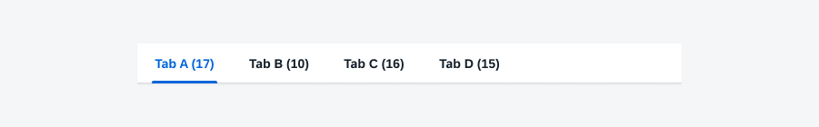
Caption: Text tabs - tab bar

### Icon tabs

Icon tabs display icons from the SAP icon font to indicate the type of content they contain. They can also include optional text labels and counters. Labels below the icon are truncated when space is limited, while labels beside the icon are always displayed in full.

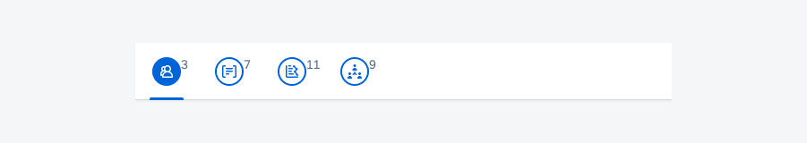
Caption: Icon tabs - tab bar

#### Filter tabs

When used as a filter, the tab bar can include an optional tab that shows all items, alongside individual tabs for each filter attribute. Show an item count on each filter tab to indicate how many items it contains.

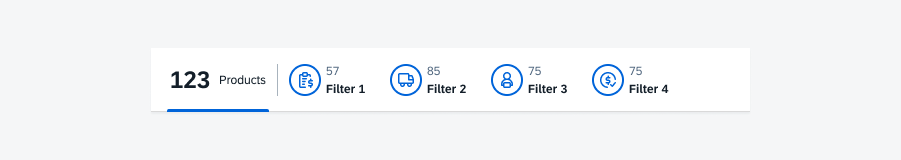
Caption: Icon and Text tabs - tab bar

### Icon and Text tabs

#### Process tabs

The tab bar can represent a process, with each tab standing for one step. Use chevron icons instead of the default separators to indicate the sequence of steps.

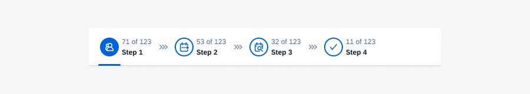
Caption: Process tabs - tab bar

## States

### Component states

Each tab in the tab bar supports two component states: enabled and disabled.

**A. Enabled:** The tab can be selected to display its content.

**B. Disabled:** The tab appears faded and cannot be selected to display its content.

Caption: Component states of the tab bar

For more information, see [Component States](https://www.sap.com/design-system/fiori-design-web/foundations/interaction/states/interaction-foundations-component-states).

### Interaction states

The tab bar supports different interaction states for text tabs and icon tabs.

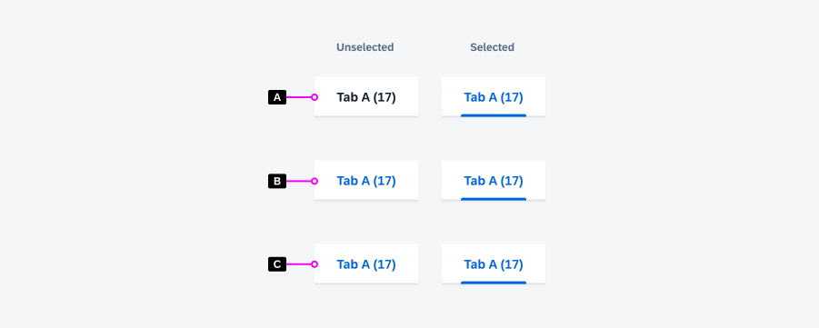
Caption: Interaction states of text tab

The text tab supports the following interaction states: regular, hover, and down. The first column shows unselected tabs, and the second shows selected tabs.

**A. Regular:** The text tab's default appearance when it is not being interacted with.

**B. Hover:** The state shown when the pointer is positioned over the text tab.

**C. Down:** The state shown when the text tab is pressed.

### Icon tab

The icon tab supports the following interaction states: regular, hover, and down.

**A. Regular:** The default appearance of the icon tab when it is neither hovered over nor pressed.
**B. Hover:** The appearance of the icon tab when the pointer is positioned over it.
**C. Down:** The appearance of the icon tab while it is being pressed.

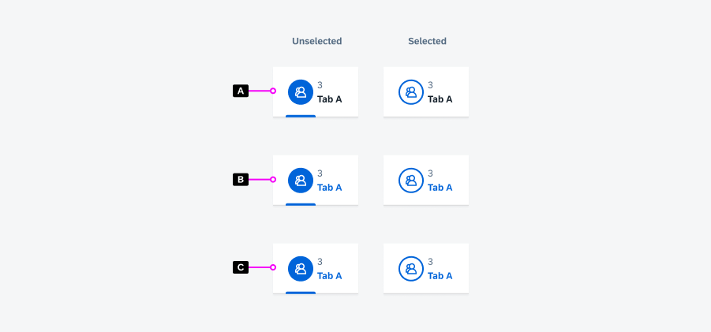

Interaction states of icon tab

For more information, see [Interaction States](https://www.sap.com/design-system/fiori-design-web/foundations/interaction/states/interaction-foundations-interaction-states).

### Value states

The value states of the tab bar are defined by the tab, which supports value states to indicate the following statuses:

**A. Negative:** Indicates an error or a condition that requires corrective action.

**B. Critical:** Flags a situation that may need attention but is not an error.

**C. Positive:** Confirms a successful or completed condition.

**D. Neutral:** Applies a neutral color when no semantic meaning is needed.

Each value state is shown across four tab presentations, from left to right:

- **Unselected text tab** (first column): The semantic color applies to the label and icon.
- **Selected text tab** (second column): The same semantic color, with a selection bar in the matching color.
- **Unselected icon tab** (third column): Semantic color on the icon and its status icon.
- **Selected icon tab** (fourth column): Icon filled with the semantic color, plus a matching selection bar.

Caption: Value states of tab bar

For more information, see [Value States](https://www.sap.com/design-system/fiori-design-web/v1-142/foundations/interaction/states/interaction-foundations-value-states).

### Focus states

The focus state indicates which component, or element within the component, will receive the user's input when using an input device such as a keyboard.

**A. Unfocused:** Applies to all tab bar elements that are not focused.

**B. Focused:** Visualized by an additional border around the focused tab bar element.

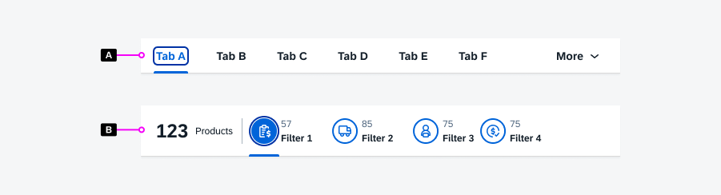
Caption: Focus states of tab bar

For more information, see [Focus state](https://www.sap.com/design-system/fiori-design-web/v1-136/foundations/interaction/states/interaction-foundations-focus-states).

## Behavior and Interaction

With an expandable and collapsible content area, all tabs can be deselected so that none is active. When no tab is selected by default, clicking a tab selects it and expands its content area.

**A. Down:** Clicking Tab A applies focus and the down state, replacing hover.
**B. Selected:** On release, Tab A is selected. Focus stays, the down state returns to hover, and Tab A's content expands and is shown.

**Note:** The same interaction works in reverse. Click a tab that's already open, and its content closes and the tab turns off, leaving no tab selected.

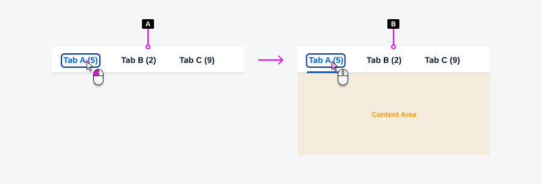
Caption: Icon and Text tabs - tab bar

In split mode, a tab has two interactive areas. Clicking the text element opens the main tab's content, while clicking the arrow element opens a menu with its subtabs.

**A. Text element:** Clicking the text element opens the parent tab's own content.

**B. Arrow element:** Clicking the arrow element opens the subtab menu.

**Note:** Selecting a subtab and all other interactions follow the same behavior described in the Tab selection sections above.

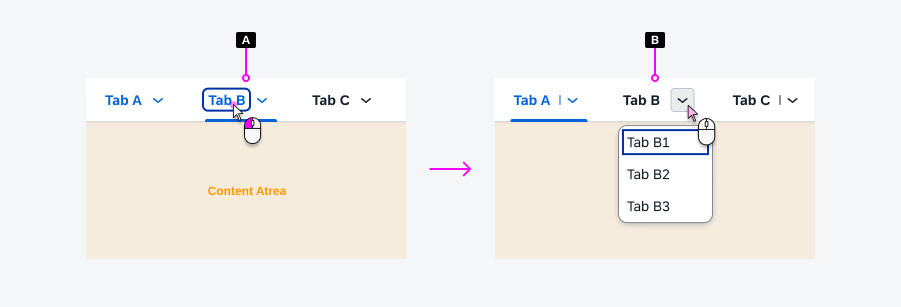
Caption: Text element (A) opens the content, arrow element (B) opens the subtab menu

In start and end mode, overflow menus can appear on both sides of the tab bar. Selecting a hidden tab moves it into the main bar in its original sequence position, so the tab order is always preserved. Tabs that no longer fit move to the overflow on the left, the right, or both sides.

The two frames below show the essential behavior: opening the overflow to reveal the hidden tabs, and the final state where the selected tab sits in its sequence position while the earlier tabs collect in the left overflow.

**A. Releasing the mouse button opens the overflow menu, with focus on the first item, Tab G. B. Opening the left overflow menu shows the first 3 tabs in their original order.**

#### Selecting a tab

Clicking an unselected tab selects it and deselects the previously selected one. Only one tab can be selected at a time.

**A. Selecting:** Tab A is selected, and its content is shown.
**B. Pressing:** The cursor moves over Tab B, applying the hover state.
**C. Selected:** Clicking Tab B applies focus and the down state, replacing hover. Tab A's content still shows.
**D. Navigated:** Tab B is selected and Tab A is deselected. The down state returns to hover, focus stays on Tab B, and Tab B's content is shown.

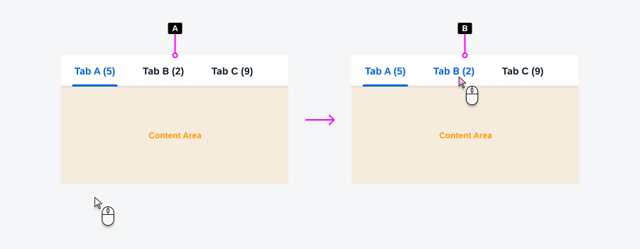
Caption: Selecting and pressing a tab - tab bar

### Tab selection

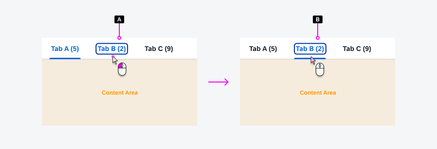
Caption: Selecting and navigating to another tab's content - tab bar

#### Expand and collapse behavior

#### Menu mode

In menu mode, clicking a parent tab opens a menu with its subtabs directly. The parent tab has no content of its own and acts only as a heading with a single interactive area.

**A. Down:** Clicking the parent tab (Tab B) applies focus and the down state.

**B. Menu open:** The menu opens directly, and focus moves to the first subtab.

**C. Down:** Moving the cursor over subtab B2 applies the hover state.

**D. Selected:** Clicking subtab B2 applies the down state. On release, the menu closes, Tab B is now selected with focus applied, and Subtab B2's content is shown.

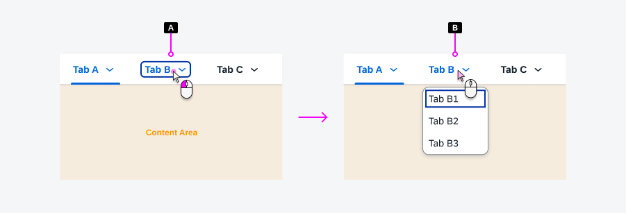
Caption: Opening the subtab menu in menu mode - tab bar

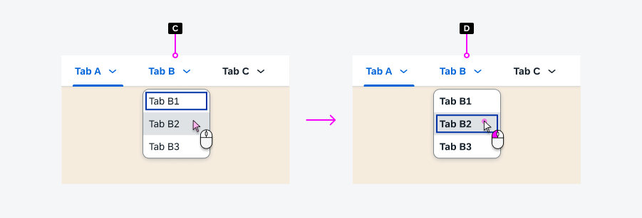
Caption: Selecting a subtab in menu mode - tab bar

### Subtabs

#### Split mode

#### End mode

In end mode, the overflow menu appears on the right side of the tab bar. Selecting a hidden tab makes it the last visible tab on the main bar, and the previously last tab moves into the overflow. The other tabs stay in place, and the original order is not preserved.

**A. The tab bar contains 11 tabs. 6 tabs are visible in the main bar and the rest are hidden in the overflow.
B. Moving the pointer over the overflow button applies the hover state.**

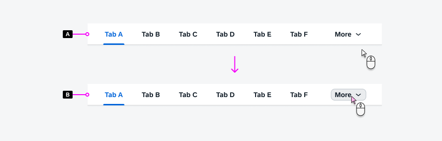

**C. Pressing the overflow button applies focus and replaces the hover state with the down state.
D. Releasing the mouse button opens the overflow menu and moves focus to the first item, Tab G. The overflow button returns to the hover state.**

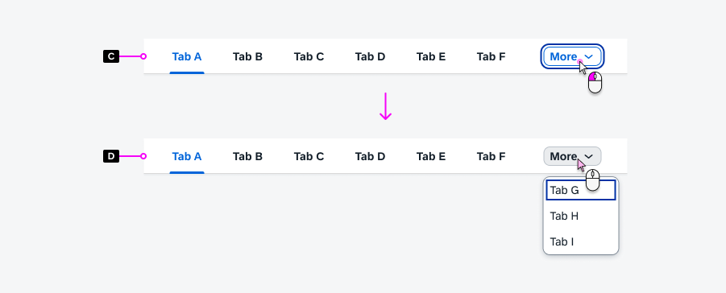

**E. Moving the pointer over Tab I applies the hover state and removes it from the overflow button. Focus remains on Tab G.  F. Pressing Tab I moves focus to it and replaces the hover state with the down state.**

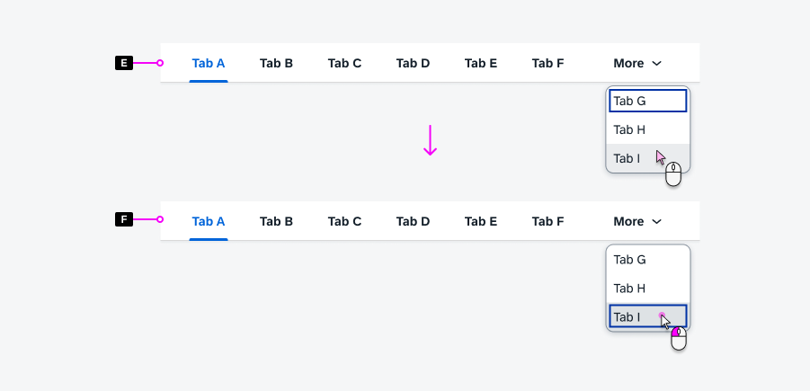

**G. Releasing the mouse button selects Tab I, deselects Tab A, and moves Tab I to the last visible position with focus. H. Opening the overflow menu shows Tab F in the menu.**

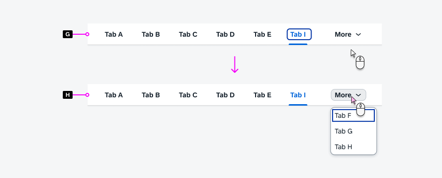

### Overflow

When there isn't enough space to show all the tabs, an overflow menu appears automatically and holds the remaining tabs. You can set the overflow mode to match your use case.

#### Start and end mode

#### Drag and drop: Placing a tab between tabs

Dragging a tab between two others reorders it at the same level. A drop handle appears to mark where the tab will land.

**A. As you start dragging Tab 4, a copy of it follows your cursor. Its old spot turns grey so you can see where it came from. B. Drag it between Tab 2 and Tab 3. Drop indicator pops up between them to show exactly where the tab will drop. C. Tab 4 lands in its new place. If it was the selected tab before, it's still selected after.**

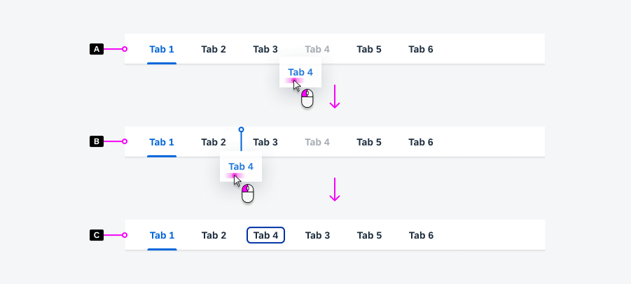

Dragging a tab onto a tab with no subtabs nests it directly as a subtab, with no other placement options.

**A. The user starts dragging Tab 4. It appears as a ghost element that follows the cursor, while its original position stays greyed out. B. The user drags Tab 4 onto Tab 6. The whole of Tab 6 highlights as the drop area, showing the tab will nest inside it.**

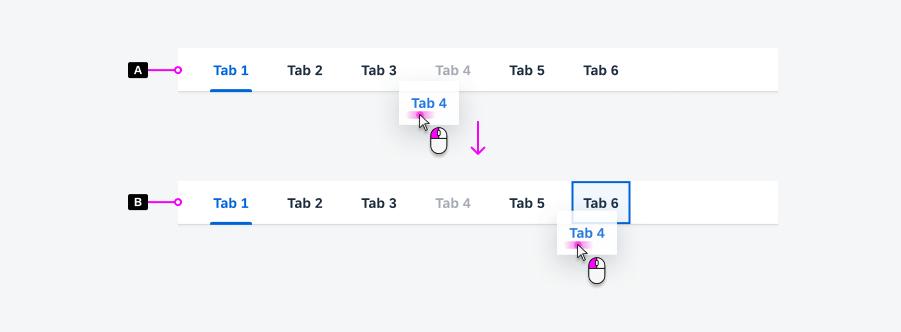

**C. The user drops Tab 4 onto Tab 6. Tab 4 becomes a subtab of Tab 6, and an arrow appears next to Tab 6 to show it now has subtabs. D. The user clicks the arrow next to Tab 6. The subtab menu opens and shows Tab 4 inside, with focus applied to it.**

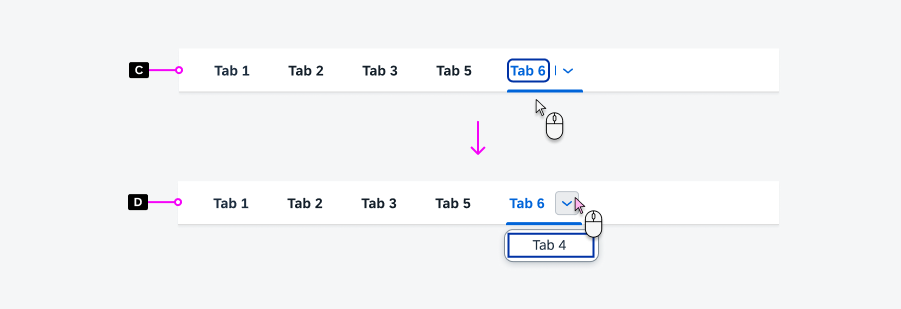

### Tab reordering

If reordering is enabled, users can rearrange tabs by dragging and dropping them across the tab bar, subtabs, and overflow menus. When nesting is also enabled, tabs can be dropped at different hierarchy levels.

#### Canceling the reordering

To cancel reordering, drop the tab anywhere outside the tab bar. The tab returns to its original position.

#### Drag and drop on a tab with subtabs

Dragging a tab onto a tab that already contains sub-tabs adds the dragged tab as an additional sub-tab at the desired hierarchy level.

1. Dropping onto the tab

**A. Users drag the ghost element of Tab 3 over a tab that already has sub-tabs, Tab 6 highlights as a drop area. B. Dropping the ghost element of Tab 3 directly onto Tab 6 adds Tab 4 to its sub-tabs. C. Opening the sub-tab menu of Tab 6 shows Tab 3 as the last sub-tab.**

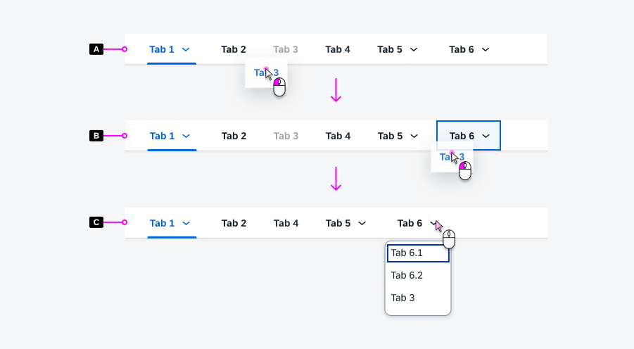

1. Opening the sub-tab menu

**A. Holding the ghost element of a tab over a tab with sub-tabs opens its sub-tab menu automatically. Focus moves to the first sub-tab. B. Dragging the ghost element between two sub-tabs displays a drop handle at the drop position. C. Dropping the tab at the drop handle inserts it as a sub-tab at that position.**

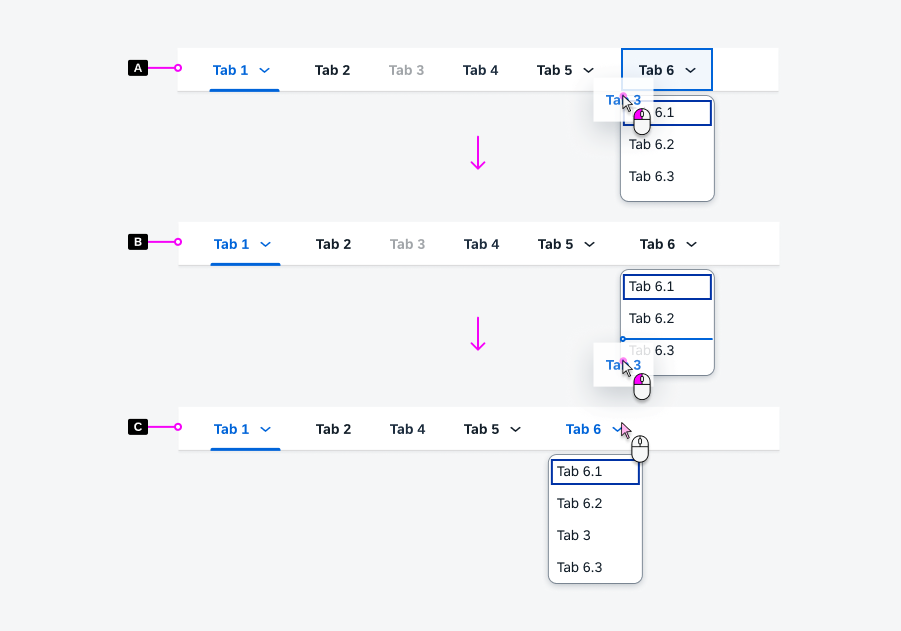

1. Dropping onto a sub-tab

**A. The user drags the ghost element of Tab 3 onto sub-tab 6.2, and sub-tab 6.2 appears as a drop target. B. Opening the sub-tab menu of Tab 6 shows Tab 3 nested under sub-tab 6.2. Focus is on sub-tab 6.1, the first sub-tab in the menu.**

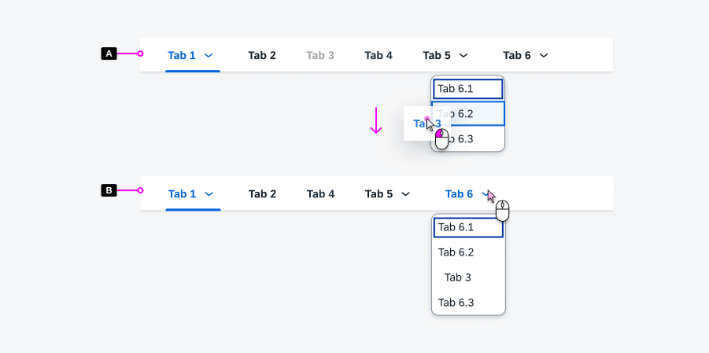

#### Drag and drop within overflow: between tabs

Dragging a tab onto the overflow button opens the overflow menu, where user choose where to place it. The user can't drop the tab on the button itself; you wait for the menu to open, then place it inside.

Dropping it between two tabs adds it at the same level, while dropping it onto a tab nests it as a subtab, if nesting is enabled. Once dropped, the overflow closes and the remaining tabs shift to fill the gap. The same interaction works in reverse, moving a tab from the overflow back to the main bar.

**A. The user drags Tab 4 onto the overflow button. B. The overflow menu opens automatically, with focus on the first item. The tab can now be placed inside the menu.**

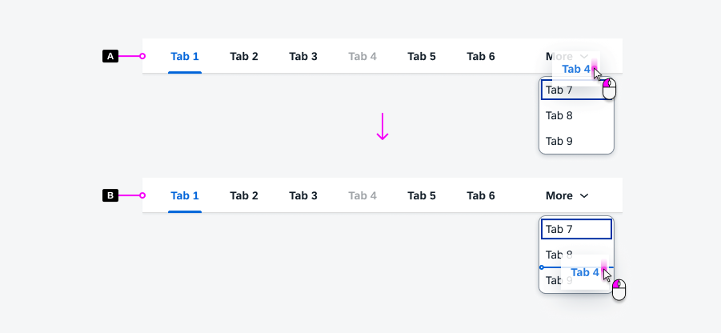

#### Drag and drop within overflow: onto tabs

Tabs inside the overflow can be reordered or nested, and moved to different hierarchy levels. When a tab with subtabs is moved, its subtabs move with it, so the hierarchy stays intact.

**A. The user drags Tab 8.1, which has its own subtab. It appears as a ghost element, and its original position is greyed out. B. The user drags it over Tab 7. A drop indicator covers the whole of Tab 7, showing the tab will nest inside it.**

**C. The user drops the tab. The overflow closes and focus returns to the selected tab. D. Reopening the overflow shows Tab 8.1 nested under Tab 7, together with its own subtab, Tab 8.1.1.**

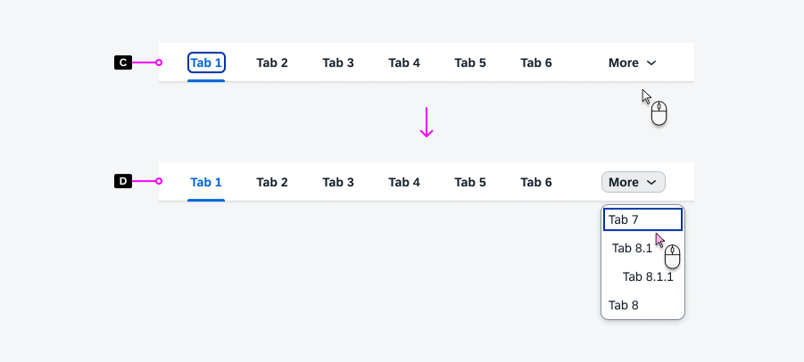

#### Drag and drop of selected tab onto overflow

Only an unselected tab can move into the overflow. Dragging the currently selected tab onto the overflow button does nothing: the menu stays closed, and the tab snaps back when the user releases it.

**A. The user drags the selected Tab 1 onto the overflow button. The menu stays closed, because a selected tab can't move into the overflow. B. The user releases the mouse button. Tab 1 snaps back to its original position and returns to its normal state.**

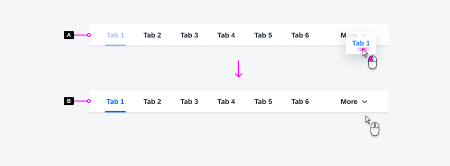

### Drag and drop: Placing tab in subtab menu and overflow menu

Dragging a tab onto another tab adds it as a subtab. A drop area appears on the target tab to show where the dragged tab will land. A tab can just as easily be moved back out: drag it from the subtab menu onto the tab bar to make it a main tab again.

### Gestures & Mapping

Touch interaction with the tab bar works like mouse interaction, without the hover effect. The following gestures trigger it:

- **Tap:** Select a tab, open the overflow, or expand and collapse a tab.
- **Drag:** Reorder a tab.
- **Swipe:** Navigate the menu or the content.

**A. The tab bar has 10 tabs, but only Tab 1 and Tab 2 fit, so the rest sit in the overflow. The user taps the overflow button. B. The overflow opens as a full-screen dialog listing all the tabs. The user taps Tab 7.**

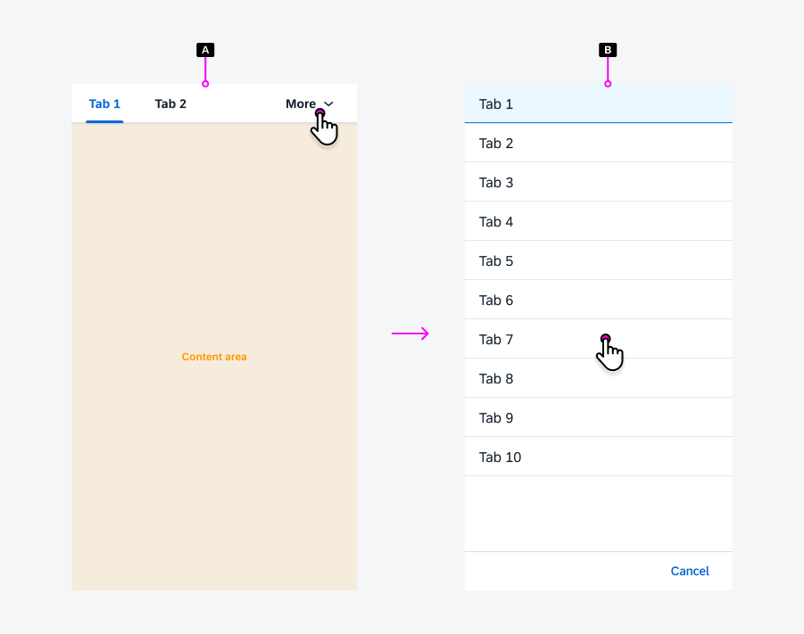

**C. The dialog closes and the tab bar returns. Tab 7 moves onto the main bar, becomes selected, and shows its content.**

**D. Reopening the overflow lists all the tabs in order, with Tab 7 selected.**

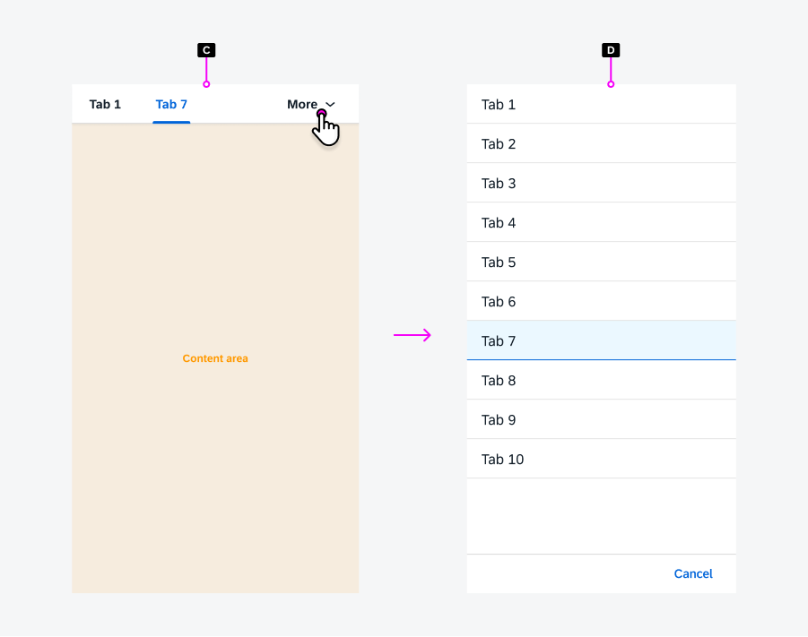

### Tooltip

You can configure a tooltip for individual tabs to give extra context about the tab's content. The tooltip appears on hover when the tab label is truncated or when the tab needs more guidance. For icon-only tabs, the tooltip conveys the tab's purpose and provides its accessible name.

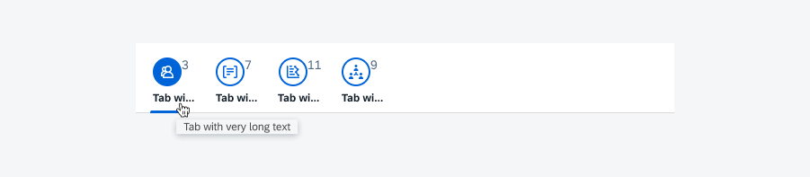
Caption: Tab with a tooltip

## Responsiveness

For more information, see [Content Density](https://www.sap.com/design-system/fiori-design-web/v1-136/foundations/visual/cozy-compact).

The tab bar adjusts how many tabs it shows based on the available horizontal space. The tab bar supports two content density modes: compact for mouse and keyboard input, and cozy for touch input.

**A: Compact:** For mouse and keyboard input.

**B: Cozy:** For touch input.

**Note:** Only the icon size changes between the modes. Text stays the same size in both.

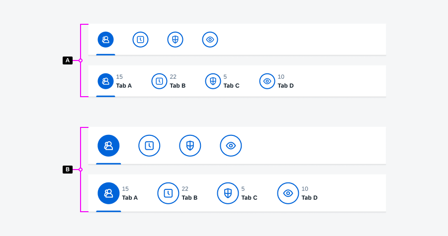
Caption: Tab bar in compact and cozy modes

## Accessibility

SAP follows international standards, such as WCAG and WAI-ARIA, and strives to make our business solutions accessible and inclusive. For more information, see [Accessibility in SAP Fiori](https://www.sap.com/design-system/fiori-design-web/discover/sap-design-system/product-standards/accessibility-in-sap-fiori) and the [Accessibility Design Tools Handbook](https://www.sap.com/documents/2023/11/bc210d8b-977e-0010-bca6-c68f7e60039b.html).

### Keyboard navigation

The following keyboard combinations are supported by the tab bar.

| **Key Combination** | **What it Does** |
| --- | --- |
| **Tab** | Moves the focus to the selected tab item within the Icon Tab Bar. If the focus is already there, the focus is moved to the next UI element. |
| **Shift + Tab** | Backward navigation (reverse tab order). |
| **Arrow Left / Arrow Up** | Moves focus to the previous tab, or does nothing if focus is already on the first tab. |
| **Arrow Right / Arrow Down** | Moves focus to the next tab, or does nothing if focus is already on the last tab. |
| **Home** | Moves focus to the first item within the icon tab bar. |
| **End** | Moves focus to the last item within the icon tab bar. |
| **Spacebar /** **Enter** | Selects the focused tab, on Space release or Enter press. In split mode, selects the parent tab. On an expandable tab, toggles its content between expanded and collapsed. If focus is on a tab close button, closes the tab. If focus is on the overflow button, opens the overflow menu. If focus is on a menu tab, opens its menu. |
| **Down** | Opens the related menu of the currently focused tab. |
| **Ctrl + Left / Up** | Moves the focused tab one position to the left, keeping focus on it. Inside a subtab or overflow menu, it moves up instead, and moving past the top of the menu returns it to the main bar. |
| **Ctrl + Right / Down** | Moves the focused tab one position to the right, keeping focus on it. Inside a subtab or overflow menu, it moves down instead, and stops at the bottom of the menu. |
| **Ctrl + Home** | Moves the focused tab to the start. In a dropdown, moves it to the top; pressing again moves it to the first tab on the main bar. |
| **Ctrl + End** | Moves the focused tab to the end. In the tab bar, pressing again moves focus to the last dropdown item. |
| **Esc** | Closes the menu without making a selection. Focus is set back to the overflow or the parent tab. |
| **Page Up** | Moves selection up by one page. If fewer items remain than the page size, selects the first item. |
| **Page Down** | Moves selection down by one page. If fewer items remain than the page size, selects the last item. |

### Screen Reader Support

For details on screen reader support and Accessible Rich Internet Applications (ARIA), see [UI5 Screen Reader Support](https://ui5.sap.com/#/topic/33fae3482358438e93daea5232527093) and [WAI-ARIA Authoring](https://www.w3.org/TR/wai-aria-1.2/).

## Content

### Localization

The tab bar component supports both left-to-right (LTR) and right-to-left (RTL) reading directions.

::: columns 2
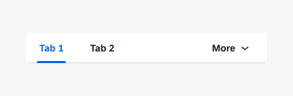
Caption: Left-to-right text directions

--- column ---

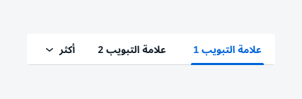
Caption: Right-to-left text directions
:::

### Wrapping and Truncation

Tab labels don't wrap. Text stays on one line and truncates with an ellipsis only for icon tabs with the label below the icon. Text tabs, and icon tabs with the label beside the icon, always show the full label.

**A. Tabs that don't truncate:** Text tabs, and icon tabs with the label beside the icon, always show the full label.

**B. Tabs that truncate:** Only icon tabs with the label below the icon truncate, using an ellipsis when space runs out.

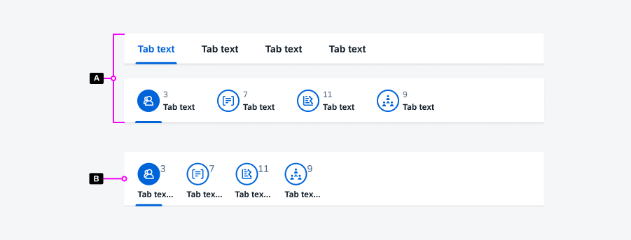

Tabs that don't truncate (A) and tabs that truncate (B)

For more information, see [Wrapping & Truncation](https://www.figma.com/design/7lMqfFtQTQWVpQsGte2cgB/Wrapping-and-Truncation?node-id=1762-2154&p=f&t=k35Wql5A7kDen2CK-0).

#### Overflow display

When there isn't enough space for all the tabs, the ones that don't fit move into an overflow menu, on the right by default or split across both sides. Use both sides for processes with a fixed order, so tabs keep their sequence; use a single overflow on the right for tabs that can be rearranged.

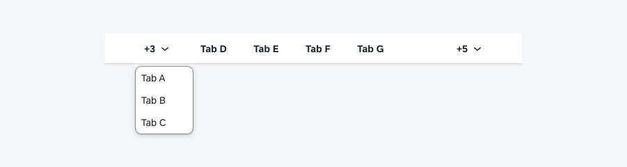

Tab bar with overflow on both sides

#### Tab variants within the overflow

Tab variants appear differently inside the overflow menu, depending on which one you use:

- **Text tabs with separator:** The label appears with its separator carried into the menu.
- **Icon tabs:** The icon appears alongside the label so the tab stays recognizable without relying on position.
- **Filter and process tabs:** The count or step indicator appears with the label, keeping the filter value or process order clear.
- **Tabs with subtabs:** The parent tab appears with its subtabs nested beneath it, preserving the hierarchy.

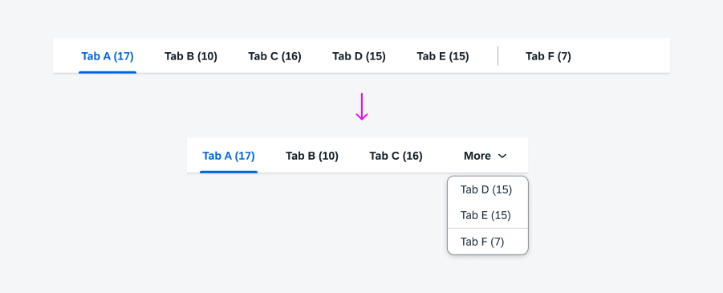

Text tabs with separator

Icon tabs

Filter and process tabs

Tabs with subtabs

#### Overflow text

Use "More" (A) for a simple label, or "+N" (B) when you want to indicate exactly how many tabs are hidden.

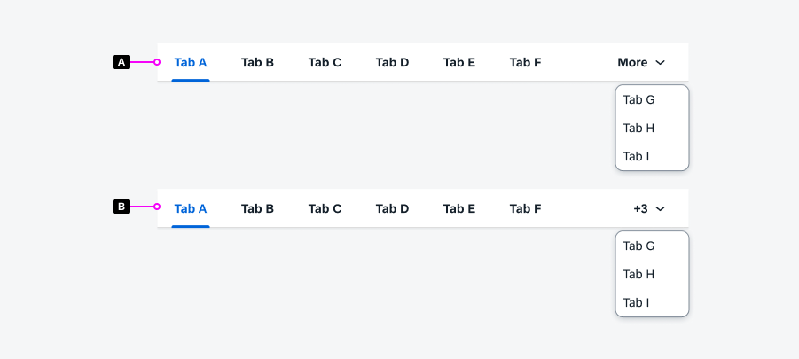

Text tabs with separator

#### Overflow on mobile phones

On small touch devices, overflow and subtab menus open as full-screen dialogs instead of popovers, using the responsive popover component.

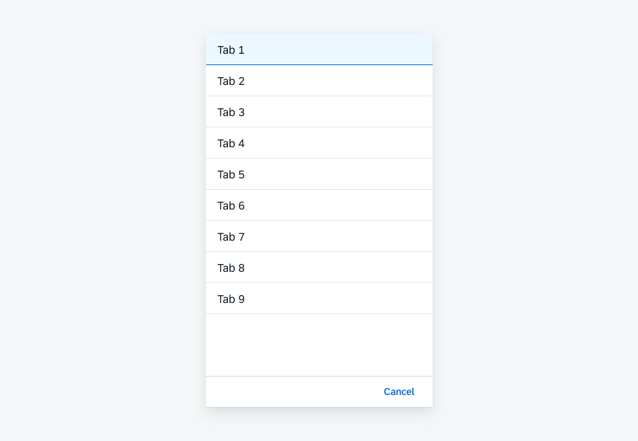

Overflow menu as a full-screen dialog

### Overflow behavior

When the tabs don't all fit, the tab bar collapses the extra ones into an overflow menu. You can control where the overflow appears and how it behaves.

## Features

### Count placement

Caption: Tabs with different count placement

The count can appear in a tab in two ways: in brackets after the label, or as a separate element positioned above the label (or next to the icon, if the tab has one).

**A. Count next to text:** The count sits in brackets after the label

**B. Count as a separate element:** The count appears above the label, or next to the icon if the tab has one.

**Note:** For text tabs, show the count after the label.

### Text placement for icon tabs

Caption: Text placement for icon tabs

Place the label next to the icon when possible. Alternatively, position it below the icon.

**A. Horizontal:** Text next to the icon.
**B. Vertical:** Text below the icon.

### Background design

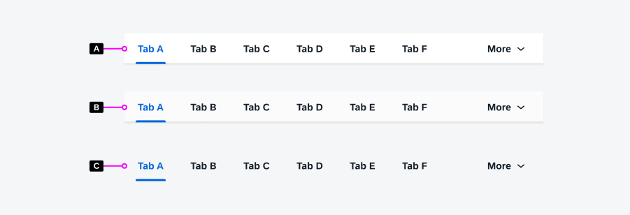
Caption: Background design examples of tab bar header

The tab bar supports three background settings that can be applied independently to the header bar and content area: solid (A), transparent (B), and translucent (C).

**Note:** The effect of the transparent and translucent settings depends on the container's background.

### Expandable and collapsible tabs

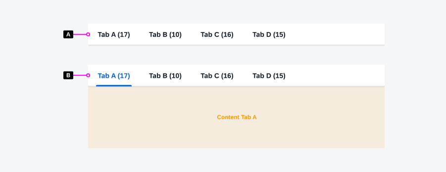
Caption: Background design examples of tab bar header

The tab bar can expand or collapse its content area when the user interacts with a tab. Pressing the selected tab toggles its content between collapsed (A) and expanded (B).

### Custom separator

Caption: Tab bar with custom separator

The tab bar supports custom separator icons instead of the default line to visually reinforce the relationship between tabs, such as chevrons that indicate the sequence of process steps.

### Initial tab selection

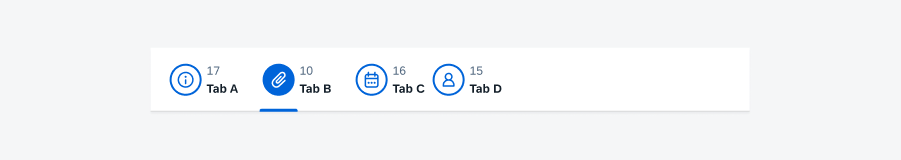
Caption: Tab bar with initial selection on the second tab

By default, the tab bar opens with the first tab selected, though you can set any tab as the initial selection.

### Badges

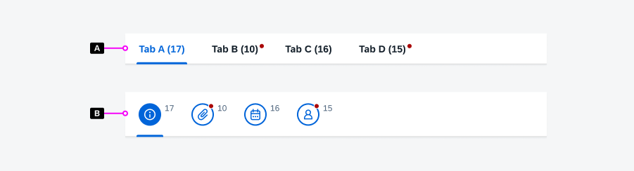

Badges on text and icons tab types

Caption: Badges on semantic and overflow tab types

The tab bar supports badges on individual tabs to signal that the system has added new items. A badge can also appear on the overflow button when one or more hidden tabs contain new items, and inside the overflow menu, each affected tab carries its own badge.

**A. Badges on text tabs:** The badge appears on the tab, next to its label, marking that the tab's content has new items.

**B. Badges on icon tabs:** On the top-right of the icon, a dot stays visible even without a text label.

**C. Badges on semantic tabs:** The badge takes the tab's semantic color instead of the default red, so it stays consistent with the tab's positive, critical, or negative state.

**D. Badges in the overflow:** When a hidden tab has new items, a dot marks the overflow button, and each affected tab inside the menu carries one too.

**Note:** Badges are red by default. If a tab has a semantic state, its badge color matches that state.

## Framework Comparison

The table below summarizes the differences between SAPUI5 and SAP Web Components and lists the framework-specific patterns.

Available

Not available

To request this feature for SAP Web Components, submit an InnerSource [request](https://sap.sharepoint.com/sites/204212/SitePages/Request.aspx).

| **Features** | **SAPUI5** | **SAP Web Components** |
| --- | --- | --- |
| Uses a custom separator icon instead of the default line, to reinforce the relationship between tabs. | Available | Not available |

## Related Links

### Guidelines

Components

[Button](https://www.sap.com/design-system/fiori-design-web/v1-136/ui-elements/button-web-component)

[Split Button](https://www.sap.com/design-system/fiori-design-web/v1-136/ui-elements/split-button-web-component)

[Segmented Button](https://www.sap.com/design-system/fiori-design-web/v1-136/ui-elements/segmented-button-web-component)

[Menu](https://www.sap.com/design-system/fiori-design-web/v1-136/ui-elements/menu-web-component)

Elements and Controls

[How To Use Semantic Colors](https://www.sap.com/design-system/fiori-design-web/v1-136/foundations/visual/how-to-use-semantic-colors)

[Button](https://www.sap.com/design-system/fiori-design-web/v1-136/ui-elements/button-web-component)

[Split Button](https://www.sap.com/design-system/fiori-design-web/v1-136/ui-elements/split-button-web-component)

[Segmented Button](https://www.sap.com/design-system/fiori-design-web/v1-136/ui-elements/segmented-button-web-component)

[Menu](https://www.sap.com/design-system/fiori-design-web/v1-136/ui-elements/menu-web-component)

[Icon Tab Bar](https://ui5.sap.com/#/entity/sap.m.IconTabBar) (samples)

[Icon Tab Bar – Badges](https://ui5.sap.com/#/entity/sap.m.IconTabBar/sample/sap.m.sample.IconTabBarBadges) (samples)

[Icon Tab Bar](https://ui5.sap.com/#/api/sap.m.IconTabBar) (API reference)

### Implementation

SAPUI5

[Icon Tab Bar](https://ui5.sap.com/#/entity/sap.m.IconTabBar) (samples)

[Icon Tab Bar – Badges](https://ui5.sap.com/#/entity/sap.m.IconTabBar/sample/sap.m.sample.IconTabBarBadges) (samples)

[Icon Tab Bar](https://ui5.sap.com/#/api/sap.m.IconTabBar) (API reference)

UI5 Web Components

[Tab Container](https://ui5.github.io/webcomponents/components/TabContainer/)

### Specifications

[Tab Bar](https://wiki.one.int.sap/wiki/spaces/visualcore/pages/2822229674/Tab+Bar+Horizon) (visual design)

[Icon Tab Bar](https://wiki.one.int.sap/wiki/pages/viewpage.action?pageId=2698913732) (visual design specification)

[Icon Tab Bar – Badges](https://wiki.one.int.sap/wiki/pages/viewpage.action?pageId=2698913813) (visual design specification)

[Semantic Colors](https://wiki.one.int.sap/wiki/pages/viewpage.action?pageId=2650676507) (visual design specification)

[Badges](https://wiki.one.int.sap/wiki/pages/viewpage.action?pageId=2697902638) (visual design specification)

### SAP Web UI Kit

[Tab Bar](https://www.figma.com/design/SILcWzK5uFghKun9jx6D7c/SAP-Web-UI-Kit?node-id=1216-3190)[ (Figma)](https://www.figma.com/design/SILcWzK5uFghKun9jx6D7c/SAP-Web-UI-Kit?node-id=1216-3190)

## Related Links (external only)

### Guidelines

Components

[Button](https://www.sap.com/design-system/fiori-design-web/v1-136/ui-elements/button-web-component)

[Split Button](https://www.sap.com/design-system/fiori-design-web/v1-136/ui-elements/split-button-web-component)

[Segmented Button](https://www.sap.com/design-system/fiori-design-web/v1-136/ui-elements/segmented-button-web-component)

[Menu](https://www.sap.com/design-system/fiori-design-web/v1-136/ui-elements/menu-web-component)

Elements and Controls

[How To Use Semantic Colors](https://www.sap.com/design-system/fiori-design-web/v1-136/foundations/visual/how-to-use-semantic-colors)

### Implementation

SAPUI5

[Icon Tab Bar](https://ui5.sap.com/#/entity/sap.m.IconTabBar) (samples)

[Icon Tab Bar – Badges](https://ui5.sap.com/#/entity/sap.m.IconTabBar/sample/sap.m.sample.IconTabBarBadges) (samples)

[Icon Tab Bar](https://ui5.sap.com/#/api/sap.m.IconTabBar) (API reference)

UI5 Web Components

[Tab Container](https://ui5.github.io/webcomponents/components/TabContainer/)

### UI Kit (Figma)

[SAP Fiori for Web UI Kit ](https://www.figma.com/community/file/1494295794601744471)[/](https://www.figma.com/community/file/1494295794601744471)

Tab Bar
